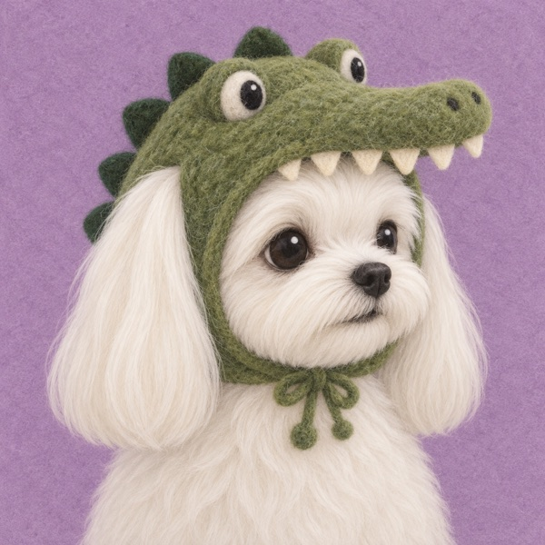
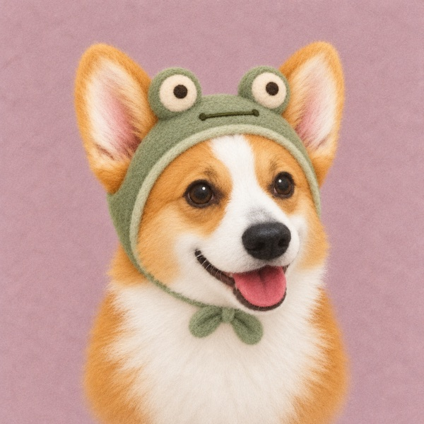
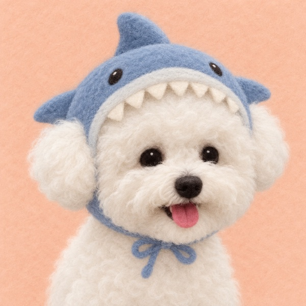
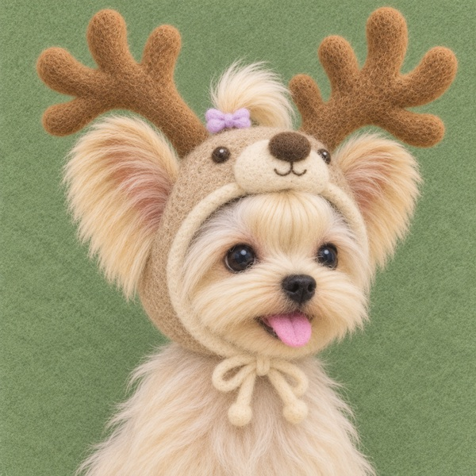
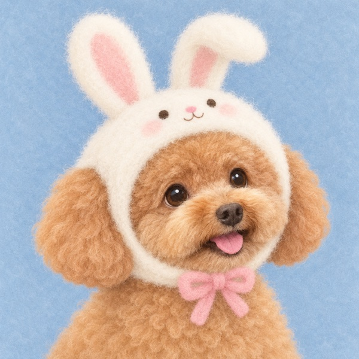
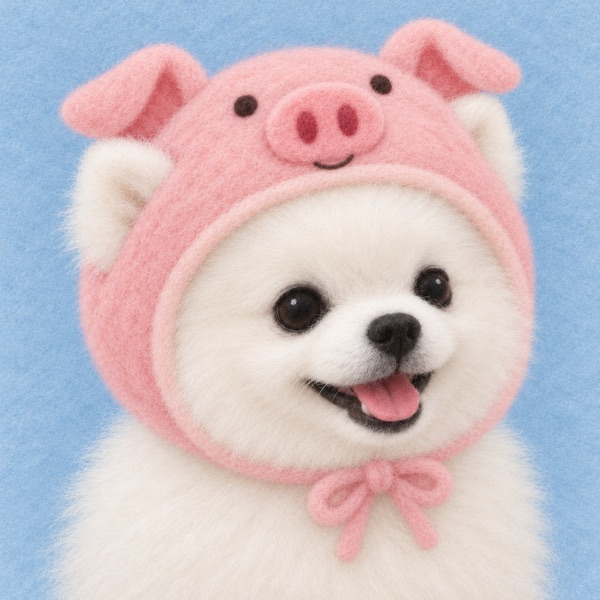
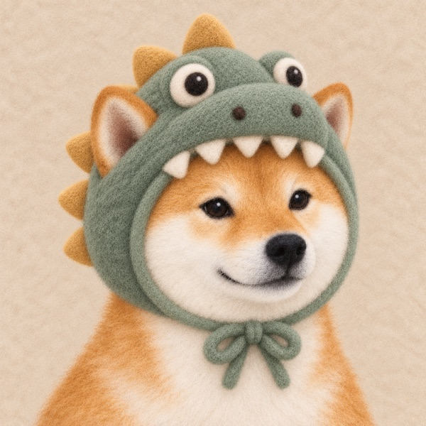
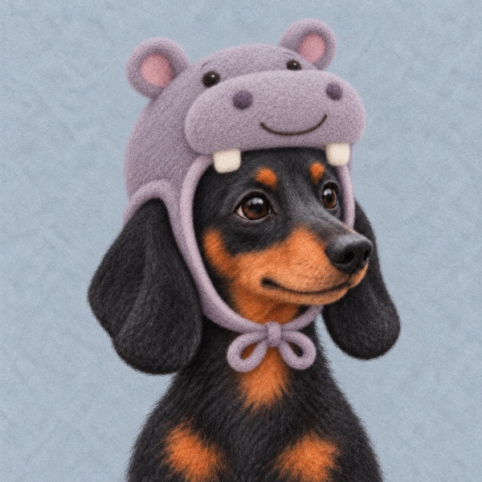

# 毛绒帽帽宠物头像

一个适用于 Codex 的图像生成 Skill：从真实猫狗照片提取个体特征，先设计卡通造型，再赋予细密毛毡质感。

## 案例展示

同一种毛毡风格，不同的宠物、帽子和配色。点击图片查看完整原图。

| 白色小狗 · 鳄鱼帽 | 柯基 · 青蛙帽 |
| :---: | :---: |
|  |  |
| **比熊 · 鲨鱼帽** | **约克夏 · 麋鹿帽** |
|  |  |
| **泰迪 · 兔子帽** | **博美 · 小猪帽** |
|  |  |
| **柴犬 · 恐龙帽** | **腊肠 · 河马帽** |
|  |  |

## 使用

将本仓库放入 `~/.codex/skills/pet-felt-avatar`，在支持内置图像生成的 Codex 会话中上传宠物照片，并使用：

> 使用 $pet-felt-avatar，为这只小狗生成头像，戴上鳄鱼帽。

也可以上传角色图片作为帽子设计参考。未指定帽子时，Skill 会结合宠物特征选择主题和背景配色。

## 默认效果

- 单宠、1:1、头部摆正、轻度 3/4 转头，头与完整帽子居中。
- 保留毛色、脸型、吻部、耳型等可见辨识特征。
- 动物、物体、食物、植物或卡通形象帽子。
- 单一底色的细密毛毡背景，按宠物与帽子搭配颜色。
- 生成后检查身份、构图、材质与背景，最多两次定向修复。

## 文件

- `SKILL.md`：入口与工作流。
- `agents/openai.yaml`：Codex 显示信息。
- `references/`：身份提取、提示词、风格分析与审核标准。
- `assets/style-refs/`：用户提供的私人风格参考。
- `assets/examples/`：8 张公开展示案例的原图与轻量预览图。

## 素材说明

案例展示图片由仓库维护者提供并选择公开展示，不包含宠物原始照片。`assets/style-refs/` 是既有风格分析参考，与案例成图区分；本仓库不为参考图片额外授予再分发许可。生成效果依赖工具，不能保证每次完全还原个体。
